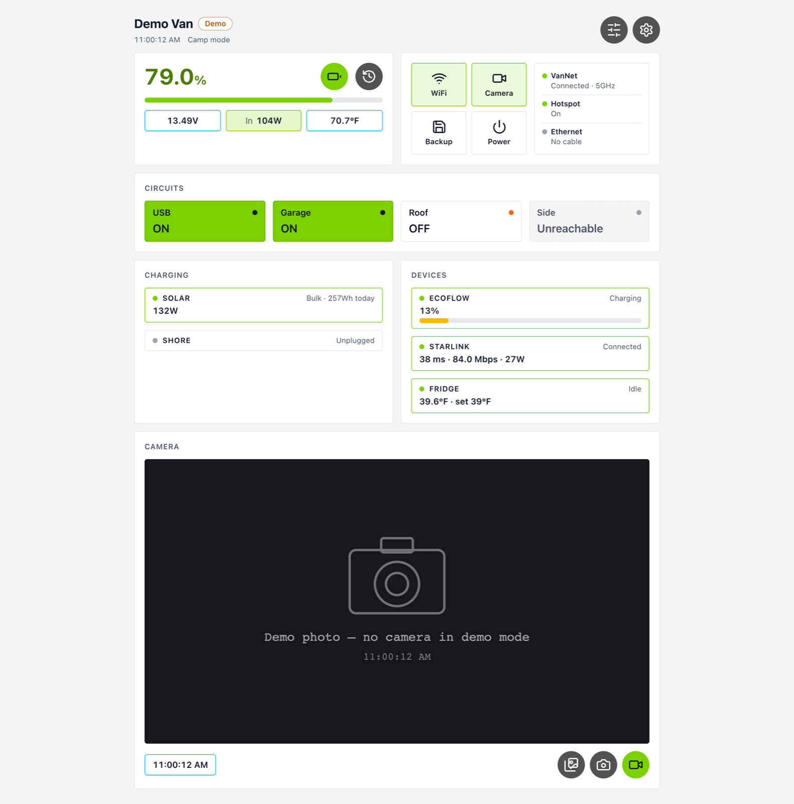
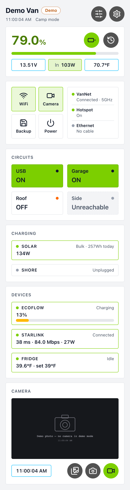
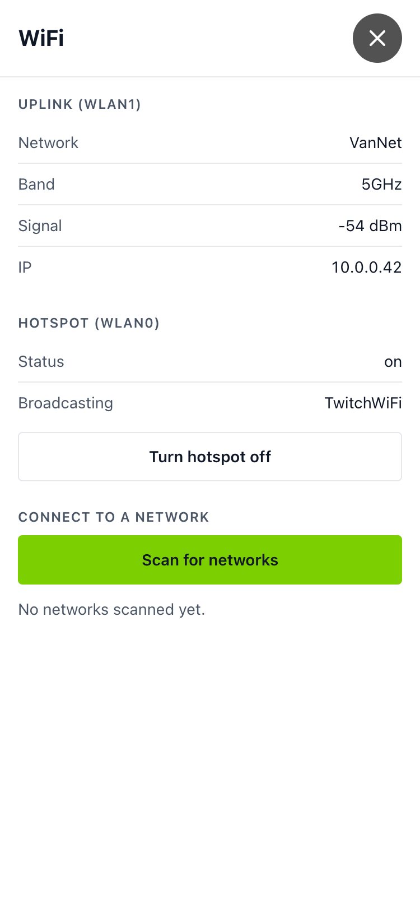
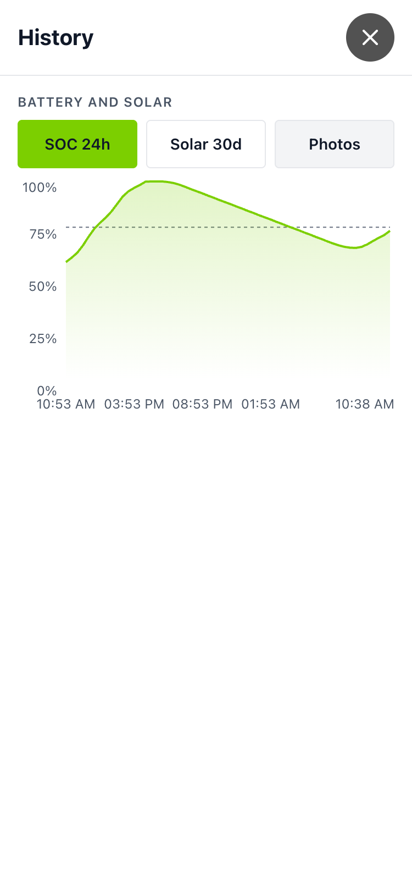
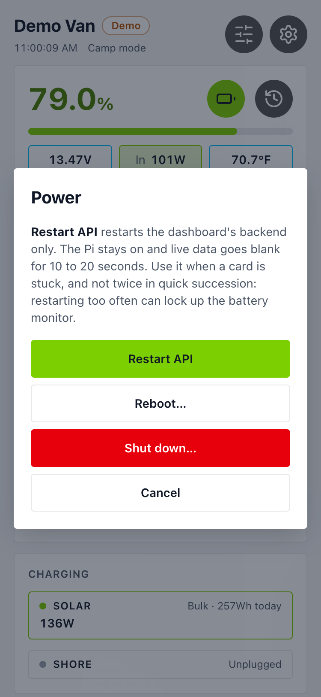

# Van Control Panel


**Last updated:** 2026-11-27
> A self-hosted monitoring and control dashboard for a 2023 Mercedes Sprinter VS30 AWD 144" High Roof conversion.





---

## What This Is

A dashboard running on a Raspberry Pi 4B in the van's electrical cabinet. It reads
the 12V LiFePO4 system over Bluetooth, controls smart relays over WiFi, logs
everything to SQLite, and is reachable from a phone anywhere via Tailscale.

Everything runs locally. No cloud services, no vendor accounts, no subscriptions.
The only outbound dependency is Tailscale for remote access.

**Where it stands (2026-11-20).** The dashboard was rebuilt in November on a
small component set of its own (see [Tech Stack](#tech-stack)). That rebuild has
been checked in the demo only, with no Pi attached, and has not been deployed to
the van yet. The backend features added since are marked *not yet run on the Pi*
in the tables below.

---

## Demo

A deployed version with physically modelled fake data runs on Vercel. Solar
follows a bell curve, SOC integrates against a baseline load, and the history
charts come from the same simulation as the live values, so they agree with each
other rather than being random noise.

Run it locally:

```bash
cd frontend && VITE_DEMO=true npm run dev
```

Built for a phone first, since that is how it is used in the van. These are
the demo at 375px: the dashboard, the WiFi drawer, the battery history drawer
and the Power dialog (Restart API is two taps from the dashboard).

<p>
  
  
  
  
</p>

---

## What actually works

| Feature                                     | Detail                                                           |
| ------------------------------------------- | ---------------------------------------------------------------- |
| **Battery** — Power Queen 100Ah LiFePO4 BMS | SOC, voltage, current, temperature, per-cell voltages over BLE. The volt, watt and temperature chips tint when a reading nears the pack's limits |
| **Solar** — Victron SmartSolar MPPT 75/15   | Panel watts, charge state, daily yield from BLE advertisements   |
| **Fridge** — Dometic CFX5 35                | Temp, set point, compressor, door, power source via an ESP32 BLE bridge |
| **Starlink Mini**                           | Latency, throughput, obstruction, and measured power draw over local gRPC |
| **EcoFlow River 2 Max**                     | Battery % decoded from the raw BLE advertisement — no auth, no cloud |
| **Smart relays** — Shelly 1 Gen4 ×4 configured | USB outlets, garage, PS Input 1 and 2 — all on the Pi's own hotspot (10.42.0.x), local HTTP, no cloud. The two PS Input units are currently unreachable. An unreachable unit shows as its own state, not as "off", and can be paused and re-checked by tapping its tile (*not yet run on the Pi*) |
| **Camera** — Logitech C922, one, inside the van | Timed captures at the active mode's interval (24h retention) plus on-demand snapshots, with UVC settings re-applied before each shot |
| **History** — SQLite, four tiers            | Raw → hourly → daily → monthly, automatic rollup and pruning     |
| **Operating modes**                         | Storage / Camp / Trail / In Town, persisted across restarts      |
| **Pi health**                               | CPU temp, load, memory, disk, uptime, undervoltage flags         |
| **Networking**                              | Dual WiFi with automatic failover, switchable from the dashboard |
| **Event log**                               | Every state change recorded — toggles, mode changes, reboots     |
| **Backups**                                 | Nightly snapshot over Tailscale, plus on-demand download. The Backup drawer also has a button that writes a gzipped image of the whole SD card to a USB stick (*not yet run on the Pi*) |
| **Offline devices**                         | A device that stops answering keeps its last reading on screen, dimmed, with its age. Tapping an offline circuit, Starlink or the fridge checks it up to three times; the BMS has a Retry now button. Polling backs off while a source is down (*not yet run on the Pi*) |
| **Remote access**                           | Tailscale — works from any network                               |

## Not built yet

Stated explicitly, because a README claiming hardware that isn't there is worse
than one admitting the gaps.

| Feature                 | Why not                                                                |
| ----------------------- | ---------------------------------------------------------------------- |
| **A second camera**     | Not planned for now. There is one camera, and the API still has an unused second slot |
| **Shore power**         | Inferred from the BMS/MPPT current delta — no charger telemetry        |
| **Measured load**       | Load is inferred from the BMS and MPPT. A Victron SmartShunt would measure it, and none is planned |
| **DC-DC charger**       | Orion-Tr 12/12-18 is non-smart. Static config only                     |
| **Fridge control**      | Reading works. Writing (set temp, on/off) is supported by the component but not wired up |
| **Garmin PowerSwitch**  | BlueZ can't connect. Protocol is undocumented — see 2026-08-27 review |
| **Maxxfan relay**       | Tested and rejected — defaults open on power loss, no network path |
| **Applying modes to the Shellys** | The camera interval follows the mode. Relay schedules from a mode are not applied |

---

## Tech Stack

**Frontend** — Vite, React 18, TypeScript, Tailwind, Zustand, Recharts, React Router.
Served in production by a small Express server that also proxies the API and
handles auth.

The UI was designed in Figma ([Van Control Panel — Dashboard UI](https://www.figma.com/design/793FjJIPcg092uFJuGnVe6/Van-Control-Panel-%E2%80%94-Dashboard-UI))
and rebuilt in November 2026 from that file: lighter surfaces, bold state colour,
one drawer per concern instead of one settings panel. The screenshots above are
that build, running on demo data.

- **No UI component library.** A small set of its own lives in
  `frontend/src/components/ui/`. Drawers and dialogs are the native `<dialog>`
  element, so focus handling, Escape and the backdrop come from the browser.
- **Design tokens in one place** (`tailwind.config.ts` and CSS variables), used by
  name (`on`, `off`, `warn`, `info`) rather than as raw colours.
- **Phone first.** Designed and checked at 375px, then 768 and 1280. Tap targets
  are at least 44px and inputs are 16px so iPhones do not zoom on tap.
- `npm run dev` also serves `/components`, a gallery of every component in every
  state (dev server only, not in the production build).

Rules and the component list: [Design System](docs/DESIGN-SYSTEM.md) and
[UI Patterns](docs/UI-PATTERNS.md).

**Backend** — FastAPI on uvicorn. `bleak` for BLE, `victron-ble` for the MPPT,
a vendored fork of `pq_bms_bluetooth` for the BMS, `httpx` for the Shellys,
`starlink-grpc-core` for the dish, SQLite for storage.

**Firmware** — an ESP32-S3 running ESPHome bridges the Dometic fridge, which
BlueZ cannot talk to at all. It exposes a local JSON API the Pi polls like any
other WiFi device.

**Infrastructure** — Raspberry Pi 4B, nginx on :80 in front of the Express
server, Starlink Mini with a home network as fallback, Tailscale, and a
self-hosted GitHub Actions runner that deploys on push.

### Notable implementation details

- **Victron data comes from BLE advertisements**, not a VE.Direct cable — the MPPT
  broadcasts encrypted manufacturer data that decrypts with a key from the app.
- **The BMS needs a persistent connection.** Rapid reconnects trigger a firmware
  lockout that is only cured by cutting the BMS's power at the house disconnect,
  so there is a 5-minute cooldown guard. The dashboard's Retry now button can cut
  that wait short, but never sooner than 2 minutes after the last failed attempt
  (*not yet run on the Pi*).
- **The fridge took an ESP32 to reach at all.** Two independent blockers: the
  CFX5 speaks a different protocol generation than the widely-forked CFX3
  component (`537a04xx`, not `537a03xx`), and it requires real BLE bonding that
  ESPHome's default client never initiates. BlueZ on the Pi can't do either.
- **EcoFlow battery % is a single unencrypted byte** in the BLE advertisement,
  at a fixed offset after the serial number. Verified against the unit's own
  screen. Everything richer than that lives behind their encrypted protocol.
- **History is downsampled server-side.** Raw endpoints bucket-average to ~300
  points rather than shipping 2,880 rows a chart can't display.
- **The API recovers from its own hangs.** Every BLE call is time-bounded and a
  watchdog replaces a frozen BMS task. A second watchdog thread kills the whole
  process if the event loop stalls for 60 seconds, and systemd restarts it. Both
  exist because each failure happened for real: the BMS stopped reporting for 8
  days, and a gRPC fork deadlock froze the API for 20+ minutes.
- **Each dashboard card polls its own endpoint.** A slow or dead device delays
  only its own card, and a stale in-flight response can't overwrite a click.
- **A dead device should not slow everything else down.** An unreachable Shelly
  costs a 3-second timeout on every poll, so a unit that keeps failing can be
  paused until someone taps its tile. Starlink and the fridge back off
  from 5 seconds to 60 while they do not answer (*not yet run on the Pi*).
- **Polling pauses when the tab is hidden**, which cut idle request volume by
  roughly 85%.
- **NetworkManager won't roam back to a preferred network** on its own — it only
  evaluates priority at boot or after a disconnect. A dispatcher script handles
  the return to Starlink. The Shellys and the ESP32 avoid the problem by joining
  the Pi's own hotspot instead of the uplink network.
- **The Pi itself runs off the EcoFlow**, not the house battery, so a low EcoFlow
  is a suspect for Pi and WiFi instability. See `docs/HARDWARE.md`.

---

## Quick Start

Open in VS Code and press **Cmd+Shift+B**, or:

```bash
# frontend — proxies to http://van-pi.local by default; set VAN_API_TARGET in frontend/.env.local for Tailscale
cd frontend && npm install --include=dev && npm run dev

# backend
cd backend && python3 -m venv .venv && .venv/bin/pip install -r requirements.txt
.venv/bin/uvicorn app.main:app --reload --port 8000
```

`--include=dev` matters if `NODE_ENV=production` is set in your shell — npm will
otherwise silently skip devDependencies, including TypeScript.

Rebuilding the Pi from a blank SD card: **[docs/SETUP.md](docs/SETUP.md)**. Most
of it is automated by `scripts/pi-setup.sh`, which is idempotent and safe to
re-run after a failure:

```bash
scp scripts/pi-setup.sh todd@van-pi.local:~/
ssh -t todd@van-pi.local 'chmod +x pi-setup.sh && ./pi-setup.sh'
```

---

## Operating Modes

| Mode      | Camera interval | Intent                                  |
| --------- | --------------- | --------------------------------------- |
| `storage` | 6 hr            | Long-term parking, battery preservation |
| `camp`    | 30 min          | Default active mode                     |
| `trail`   | 15 min          | Parked and unattended                   |
| `in_town` | 30 min          | Full connectivity                       |

The selection persists across reboots and sets the camera interval. Driving the
Shellys from it is not implemented.

---

## Access

| Scenario               | Method                |
| ---------------------- | --------------------- |
| Same network as the Pi | `http://van-pi.local` |
| Anywhere else          | Tailscale address     |

Two auth layers: a signed cookie on the Express frontend, and an API key on the
FastAPI backend for anything not arriving over loopback.

---

## Docs

- [Setup](docs/SETUP.md) — rebuild from a blank SD card
- [Troubleshooting](docs/TROUBLESHOOTING.md) — symptom-first fixes
- [Project Overview](docs/project-overview.md) — goals, scope and what is done
- [Architecture](docs/ARCHITECTURE.md)
- [API Reference](docs/API.md)
- [Hardware](docs/HARDWARE.md)
- [Operating Modes](docs/MODES.md)
- [Design System](docs/DESIGN-SYSTEM.md) — tokens and the component set
- [UI Patterns](docs/UI-PATTERNS.md) — how screens are put together
- [Design file](https://www.figma.com/design/793FjJIPcg092uFJuGnVe6/Van-Control-Panel-%E2%80%94-Dashboard-UI) — the Figma the UI was built from
- [Victron over Bluetooth](docs/VICTRON-BLE-PLAN.md) — reading the shore charger and DC-DC charger
- [Fridge bridge](docs/esp32-dometic-bridge.md) — the ESP32 that reaches the Dometic
- [Starlink status](docs/starlink-status.md) — the dish's local API
- [Future Features](docs/FUTURE-FEATURES.md) — prioritized roadmap
- [Claude Code Context](docs/CLAUDE.md) — conventions, gotchas, full system notes
- [Rubber Duck Review](docs/rubber-duck-review.md) — bugs found, and the reasoning errors behind them
- [Rubber Duck Review, 2026-08-27](docs/rubber-duck-review-2026-08-27.md) — the CFX5 protocol investigation

---

## License

MIT
